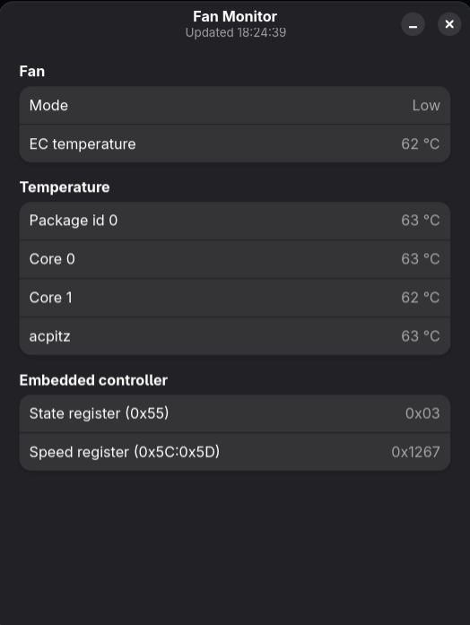

# fanmon

Fan-mode and temperature monitor for the **Acer Aspire R7-371T** (Broadwell), with a read-only EC sampler written in Rust.

The embedded controller owns the fan curve. fanmon displays the EC-selected level and its temperature alongside Linux thermal sensors; it does not control the fan.



## What it shows

| Row | Meaning |
|---|---|
| Mode | Friendly label for the EC fan level in ERAM `0x55` |
| EC temperature | EC control temperature, ERAM `0x56` |
| Temperature | `coretemp` package/cores and ACPI thermal zones |
| State register | Raw `0x55` byte |
| Speed register | Raw `0x5C:0x5D` pair |

Observed levels on the R7-371T: `0x02` at idle, then `0x03`, `0x04`, and `0x05` as temperature rises. The measured hysteresis transitions were 3→4 at about 68 °C rising / 61 °C falling, and 4→5 at about 73 °C rising / 67 °C falling. The `0x55` level scale is inferred from the sibling Acer E5-471G NBFC configuration (register 85, range 0–8); raw register values remain visible for comparison.

## Requirements

- Linux with systemd
- Rust/Cargo to build the sampler
- Python 3 with PyGObject, GTK 4, and libadwaita for the GUI
- Root access for the one-time system installation and EC reads

## Install

```sh
./install-user.sh          # GUI, desktop entry, icon
sudo ./install-system.sh   # builds Rust sampler; installs/enables socket activation
```

The system installer enables `fanmon.socket`, a small systemd listener. When the GUI connects, systemd starts a short-lived root sampler that streams snapshots while the window is open. Closing the window closes the socket and the sampler exits. **No pkexec prompt is needed on normal opens**; authentication is needed only for initial installation or repair. The GUI's “Install/Repair Sampler…” button is a fallback for that setup.

The socket is owned by the installing desktop user and mode `0600`. The installer detects the caller via `sudo`/`pkexec`; set `FANMON_USER` if installing from a root shell without a caller identity.

The installer runs `cargo build` as the desktop user and only copies the resulting binary into `/usr/local/libexec` as root; it does not execute Rust build scripts as root.

Uninstall the system-side socket and sampler with:

```sh
sudo ./uninstall-system.sh
```

Remove the user-side GUI with:

```sh
rm -f ~/.local/bin/fanmon ~/.local/share/applications/fanmon.desktop \
      ~/.local/share/icons/hicolor/scalable/apps/fanmon.svg
```

## Files

| Path | Role |
|---|---|
| `sampler-rs/` | Rust sampler; reads EC RAM and sysfs, streams newline-delimited JSON over the activated socket |
| `fanmon-gui.py` | GTK4/libadwaita GUI; opens the socket for the window lifetime and owns level labels |
| `fanmon.socket` | systemd socket, enabled at boot; starts no sampler process by itself |
| `fanmon@.service` | one root sampler instance per connected GUI |
| `install-user.sh` / `install-system.sh` | Install the GUI and the system socket, respectively |
| `.omp/skills/laptop-ec-fan-probe/` | Project-local, read-only EC investigation notes |

## Porting to another laptop

The ERAM base `0xFF70D500`, register offsets, and fan-level interpretation are specific to this EC layout. Probe read-only and correlate state bytes with EC temperature before changing labels. The project-local `laptop-ec-fan-probe` skill describes the probing procedure. Never write EC registers while probing.

## Safety

- Read-only: the sampler opens `/dev/mem` read-only and never writes to the EC.
- Fan speed remains controlled by the laptop's EC.
- CPU and iGPU workloads both heat the die; the EC reacts to temperature, not the type of workload.

## License

MIT — see [LICENSE](LICENSE).
