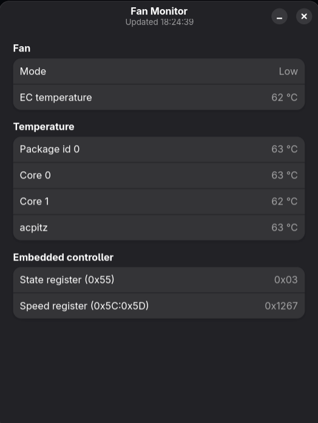

# fanmon

Fan mode and temperature monitor for the **Acer Aspire R7-371T** (Broadwell), plus
the read-only EC sampler behind it.

There is no `pwm*`/`fan*` interface in hwmon on this machine and no ACPI fan device:
the embedded controller owns the fan and decides on its own. fanmon reads the EC
state directly so you can see which level the EC has picked and at what temperature.



## What it shows

| Row | Meaning |
|---|---|
| Mode | EC fan level from ERAM `0x55`: `Off` / `Idle` / `Low` / `Medium` / `High` |
| EC temperature | EC control temperature, ERAM `0x56` |
| Temperature | `coretemp` package + cores, plus ACPI thermal zones |
| State register | Raw `0x55` byte |
| Speed register | Raw `0x5C:0x5D` pair (`0x5D` tracks the level, `0x5C` is a counter) |

Levels observed on this model, with hysteresis: `2` idle (~48–55 °C), `3` low,
`4` medium, `5` high; rising transitions at ~68 °C (3→4) and ~73 °C (4→5), falling
at ~61 °C (4→3) and ~67 °C (5→4). The register is a 0–8 fan level scale, matching
nbfc's Acer E5-471G config (register 85 = `0x55`, Min 0 / Max 8).

## Requirements

- Linux with `/dev/mem` access and `CONFIG_STRICT_DEVMEM` (the EC RAM window at
  `0xFF70D500` is below the 1 MiB strict boundary, so read-only `mmap` works).
- GTK 4 and libadwaita for the GUI (`python-gobject`, `gtk4`, `libadwaita`).
- Root for the sampler only.

## Install

Two halves, because only the sampler needs root:

```sh
./install-user.sh                 # GUI, desktop entry, icon -> ~/.local
sudo ./install-system.sh          # sampler + systemd unit, started now and at boot
```

The GUI's "Install Sampler…" button runs `install-system.sh` through `pkexec` as a
fallback if the service is missing. Authentication happens once per install — after
that systemd starts the sampler at boot and the GUI just reads
`/run/fanmon/status.json`.

After editing `sampler.py`, re-run `sudo ./install-system.sh` (root-owned copy).
After editing `fanmon-gui.py`, re-run `./install-user.sh` only.

Uninstall:

```sh
sudo ./uninstall-system.sh
rm -f ~/.local/bin/fanmon ~/.local/share/applications/fanmon.desktop \
      ~/.local/share/icons/hicolor/scalable/apps/fanmon.svg
```

## Files

| Path | Role |
|---|---|
| `sampler.py` | Root sampler: `mmap`s the EC window, writes `status.json` every second |
| `fanmon-gui.py` | GTK4/libadwaita window, polls the JSON, owns the level labels |
| `fanmon.service` | systemd unit (`Restart=always`, `RuntimeDirectory=fanmon`) |
| `install-user.sh` / `install-system.sh` | Installers; the user one bakes the source path into the installed GUI |
| `fanmon.desktop`, `fanmon.svg` | Menu entry and icon |

## Porting to another laptop

`ERAM`, the register offsets, and `STATE_NAMES` in `fanmon-gui.py` are specific to
this EC layout. Find yours by sampling EC RAM under load and correlating the state
byte with temperature — see the `laptop-ec-fan-probe` skill in `.omp/skills/`
(project-local) for the read-only probing procedure. Never write to EC registers
while probing.

## Notes

- Read-only: the sampler opens `/dev/mem` with `O_RDONLY` and never writes to the EC.
- The EC controls the fan by die temperature, so CPU and GPU load are equivalent
  heat sources on this machine — there is no separate GPU sensor.
- Do not confuse this with fan *control*: nothing here changes fan speed.

## License

MIT — see [LICENSE](LICENSE).
